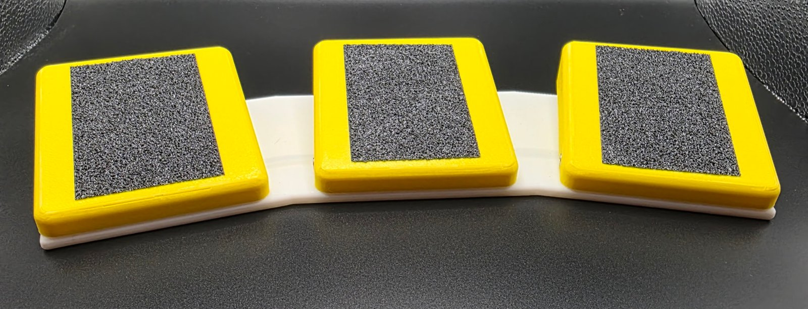
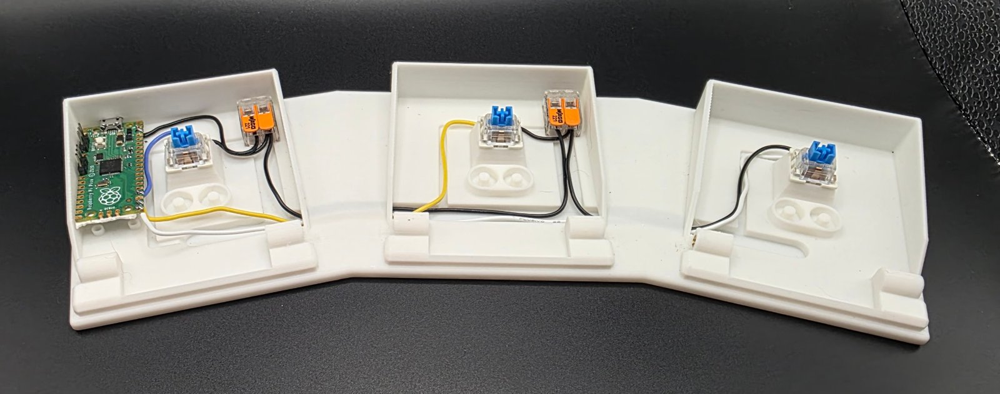
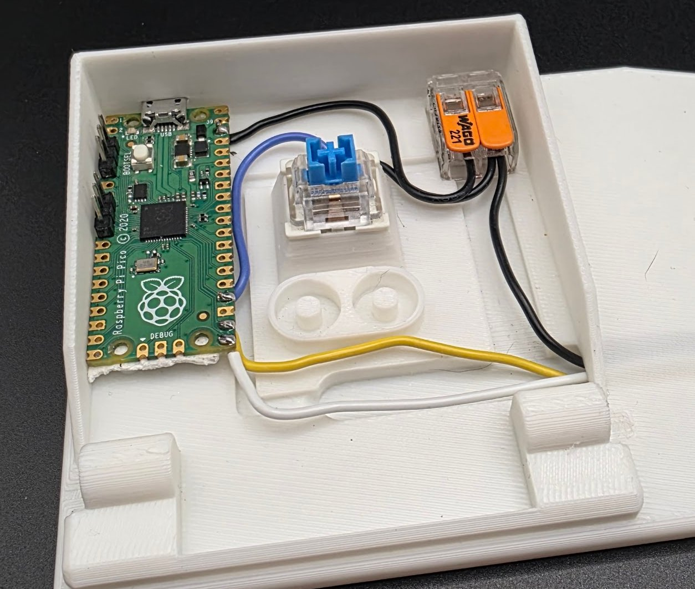
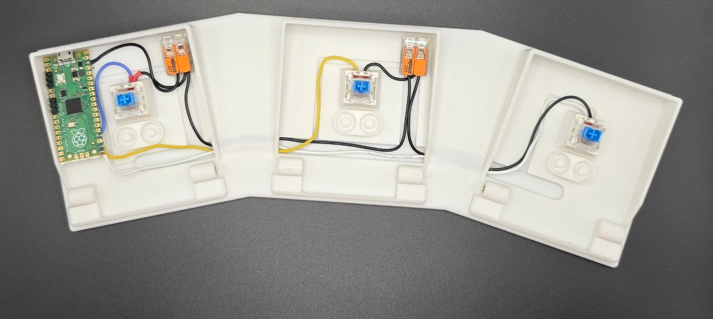
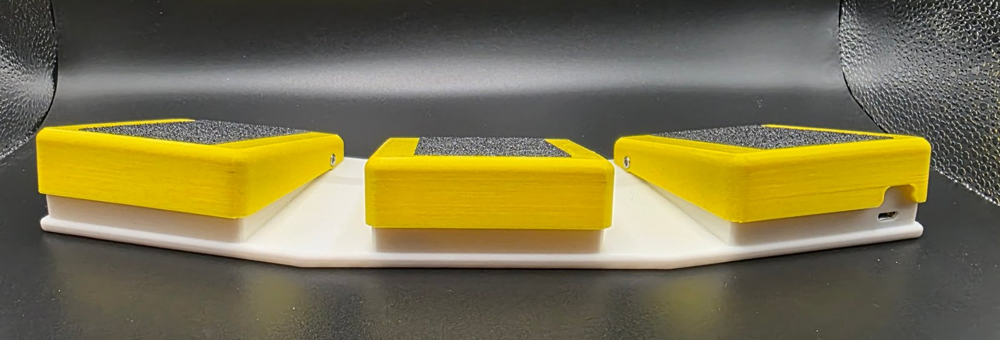

# USB Foot Pedal

A 3D-printable USB foot pedal powered by a Raspberry Pi Pico. It plugs in like a keyboard and sends whatever keys you choose, from a single key like **F13** to combos like **Ctrl+Shift+F13**. Change the keys any time with the **Pedal Config** app, with no code editing.



- **Three-pedal version** (single-pedal version coming soon)
- **No supports needed.** Every printed part prints without supports.
- **Works on any computer** as a standard USB keyboard. The app is only needed to change keys.
- Mechanical key switch inside each pedal, with real metal springs for a solid feel

Inspired by the [USB Foot Switch](https://makerworld.com/en/models/2042179-usb-foot-switch#profileId-2203328) on MakerWorld. This is a complete redesign, not a remix, so **parts are not interchangeable** with the original.

---

## What's in this repo

| Folder | Contents |
|---|---|
| [`3d-print/`](3d-print) | Printable parts (`.3mf`) |
| [`firmware/`](firmware) | `boot.py` and `code.py` for the Pico (CircuitPython) |
| [`app/`](app) | Pedal Config app source (`pedal_config.py`) |
| [Releases](../../releases) | **Pedal Config.exe**, ready to run on Windows |
| [`docs/build-notes.md`](docs/build-notes.md) | My full build log: spring testing, print settings, code history |

---

## Materials

| Item | Single | Three | Notes |
|---|---|---|---|
| Raspberry Pi Pico 1 or 2 | 1 | 1 | |
| Cherry MX–style mechanical key switch | 1 | 3 | |
| Compression spring, 3/8" × 3/4" (≈9.5 × 19.1 mm) | 2 | 6 | From the [Harbor Freight 200-piece assorted spring set](https://www.harborfreight.com/200-piece-assorted-spring-set-67562.html), which includes 10 of this size. 7/32" × 11/16" and 3/8" × 5/8" from the same set also work |
| M3 heat-set inserts | 2 | 6 | |
| M3 × 4 screws | 2 | 6 | M3 × 5 or M3 × 6 also work but are harder to tighten in the tight gap |
| M2 self-tapping screws | up to 4 | up to 4 | Optional, to mount the Pico. Hot glue works too |
| 22 AWG wire | ✓ | ✓ | Any color |
| Wago 221 lever connectors (2-port) | – | 2 | For the shared ground. Soldering the grounds together works too |
| Superglue and/or hot glue | optional | optional | Holds wire runs and the Pico in place |

> **Why not printed springs?** I tested several printable spring designs. Results were hit and miss, and 3 out of 5 failed before they could be used. Cheap metal springs are much more reliable.

---

## Printing

| Setting | Value |
|---|---|
| Material | PLA or PETG (both tested) |
| Supports | **None** |
| Layer height | 0.20 mm |
| Wall loops | 2 |
| Infill | 15% |

| File | Qty (three pedal) |
|---|---|
| `3d-print/three-pedal/TripleBaseV1.3mf` | 1 |
| `3d-print/pedals/Pedal_CutOut.3mf` | 1, the far-left pedal over the Pico (cutout for the USB port) |
| `3d-print/pedals/Pedal_NoCutOut.3mf` | 2, the middle and right pedals |

The three-pedal base is large. It prints in one piece on a bed big enough to fit it (I used a Snapmaker U1). Print settings for Bambu Lab printers are in the [build notes](docs/build-notes.md#print-settings).

---

## Wiring



The Pico sits in the **far-left pedal** (as the unit sits on the floor in front of you), with its USB port facing out the side.

Each switch has two legs. One leg goes to its own Pico pin; the other goes to ground.

| Pedal | Pico pin |
|---|---|
| Left | GP18 |
| Middle | GP17 |
| Right | GP16 |

**Ground:** Run one wire from a Pico **GND** pin to the switches. I daisy-chained it through two Wago connectors: the Pico's GND goes to Wago 1 in the left pedal, which feeds the left switch and continues to Wago 2 in the middle pedal, which feeds the middle and right switches. Where two thin wires share one Wago port, twist them together first. You can also solder the grounds together or use more than one of the Pico's GND pins.

No diodes are needed. Each pedal has its own pin, so there's no keyboard-matrix ghosting.





---

## Assembly

1. **Heat-set inserts:** Install the M3 inserts. ⚠️ **Go slow.** There's no clear straight-on angle to the holes, but with patience they go in straight.
2. **Pico:** Mount it with M2 self-tapping screws (the holes are sized at 1.8 mm), or hold it down with dots of hot glue at the corners. Keep glue off the USB port, the BOOTSEL button, and the solder joints.
3. **Switches and wiring:** Seat the switches, wire them as above, and glue the wire runs into their channels if you like.
4. **Springs:** Two per pedal, on the posts beside each switch.
5. **Pedals (three pedal):** Space between pedals is tight, so install in this order:
   1. **Middle pedal first:** with the outer pedals off, there's room for a driver on both screws.
   2. **Left and right pedals:** put in the **outside** screw first.
   3. **Inside screws:** reach into the gap with a small Allen wrench and turn a little at a time until flush on the inside.

   > ⚠️ **Don't over-tighten.** These screws are the pedal's hinge. Tighten them until they're snug, then check that the pedal still pivots freely and springs back up. If it binds, back the screws off slightly.



---

## Firmware

1. Install [CircuitPython](https://circuitpython.org/board/raspberry_pi_pico/) on the Pico ([Pico 2 page](https://circuitpython.org/board/raspberry_pi_pico2/)).
2. Copy the `adafruit_hid` folder from the [CircuitPython library bundle](https://circuitpython.org/libraries) into `CIRCUITPY/lib`.
3. Copy [`firmware/boot.py`](firmware/boot.py) and [`firmware/code.py`](firmware/code.py) onto the `CIRCUITPY` drive.
4. **Unplug and replug** the Pico.

Default keys: **Left = F13, Middle = F14, Right = F15.** F13–F24 don't exist on normal keyboards, so they never clash with typing. Map them in Stream Deck, AutoHotkey, OBS, or any app that accepts hotkeys.

**Single pedal:** in `code.py`, swap the BUILD SETTINGS lines for the single-pedal ones (GP16), and in `boot.py` set `SHOW_DRIVE_PIN = board.GP16`.

### Editing the files later

`boot.py` hides the `CIRCUITPY` drive so the pedal acts like a plain keyboard. To show the drive, **hold the far-left pedal while plugging in.**

---

## Pedal Config app

Change each pedal's key or combo without touching code. Keys are saved on the Pico itself, so they stay set after unplugging and work on any computer.

### Option 1: download the `.exe` (Windows)

Download **Pedal Config.exe** from [Releases](../../releases) and run it. If Windows Defender warns about an unknown app, choose **More info → Run anyway**.

### Option 2: run from source (any OS with Python 3.9+)

```
py -m pip install pyserial
py app/pedal_config.py
```

On macOS or Linux, use `python3` in place of `py`.

### Using it

1. Plug in the pedal and open the app. It finds the pedal automatically.
2. For each pedal, tick any modifiers (Ctrl, Shift, Alt, Win) and pick a key.
3. Click **Save to Pedal**. The new keys work immediately.

Press a pedal and its dot in the app turns green, which is handy for checking your wiring.

<details>
<summary>How the app talks to the pedal</summary>

`boot.py` turns on a second USB serial port (`usb_cdc` data), separate from the normal CircuitPython console. The app sends one-line JSON commands over it:

| App sends | Pico replies |
|---|---|
| `{"cmd": "hello"}` | `{"ok": true, "device": "foot-pedal", "version": 1, "pedals": ["Left", "Middle", "Right"]}` |
| `{"cmd": "get"}` | `{"ok": true, "keys": [["F13"], ["F14"], ["F15"]]}` |
| `{"cmd": "set", "keys": [["CONTROL", "SHIFT", "F13"], ["F14"], ["A"]]}` | `{"ok": true, ...}` |

The Pico also sends `{"event": "press", "pedal": 0}` and `"release"` events. Keys are stored in the Pico's NVM (non-volatile memory) and checked against the `Keycode` list before saving, so a bad setting can't break the pedal.

</details>

### Building the `.exe` yourself

```
py -m pip install pyserial pyinstaller
py -m PyInstaller --onefile --windowed --name "Pedal Config" app/pedal_config.py
```

The `.exe` is also built automatically by GitHub Actions whenever a new release is published.

---

## Credits

- Original inspiration: [USB Foot Switch](https://makerworld.com/en/models/2042179-usb-foot-switch#profileId-2203328) on MakerWorld
- Designed by [savethechicken](https://github.com/savethechicken)

## License

TBD. A license will be added soon. Until then, please ask before reusing or redistributing these files.
